# [Most Circulated Product](https://xuanx1.github.io/mostCirculatedproduct/)

Interactive, educational [explorers](https://xuanx1.github.io/mostCirculatedproduct/) of the security features on the highest-denomination banknote of each of the ten most traded currencies (by the BIS Triennial Central Bank Survey of foreign exchange turnover). Tilt, flip, bend, fold, explode into layers and view under ultraviolet light, with every feature labelled and explained.

| Currency | Note | Live page | Preview |
|---|---|---|---|
| US dollar | $100 Federal Reserve note (Series 2021) | [usd-100](https://xuanx1.github.io/mostCirculatedproduct/usd-100/) | 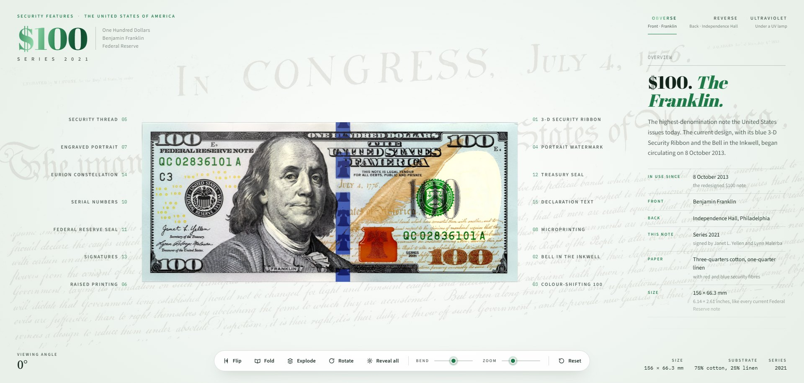 |
| Euro | €500 (first series) ¹ | [eur-500](https://xuanx1.github.io/mostCirculatedproduct/eur-500/) | 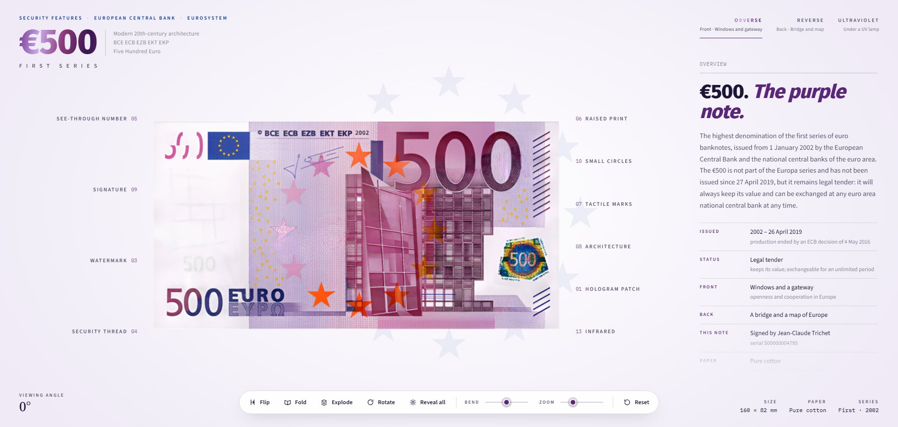 |
| Japanese yen | ¥10,000 (2024 series, Shibusawa Eiichi) | [jpy-10000](https://xuanx1.github.io/mostCirculatedproduct/jpy-10000/) | 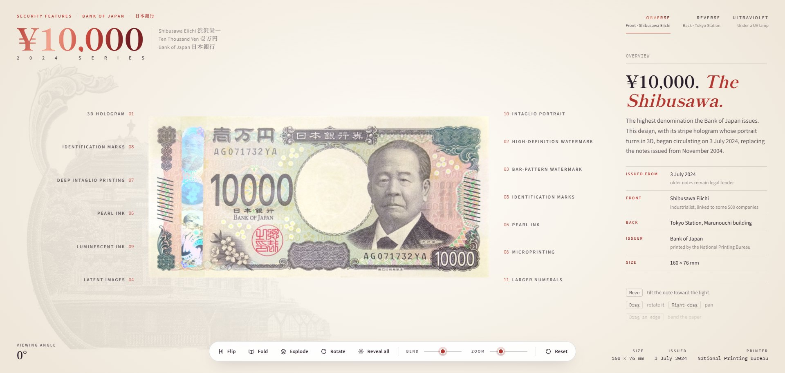 |
| Pound sterling | £50 Bank of England polymer (Alan Turing; Queen Elizabeth II version) ³ | [gbp-50](https://xuanx1.github.io/mostCirculatedproduct/gbp-50/) | 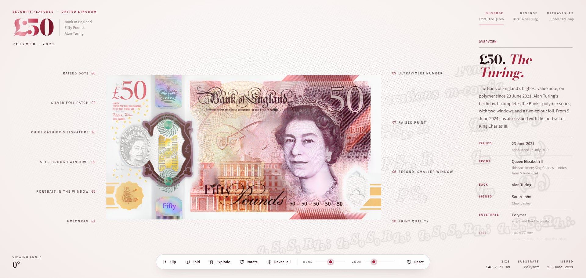 |
| Chinese renminbi | ¥100 (2015 edition) ⁴ | [cny-100](https://xuanx1.github.io/mostCirculatedproduct/cny-100/) | 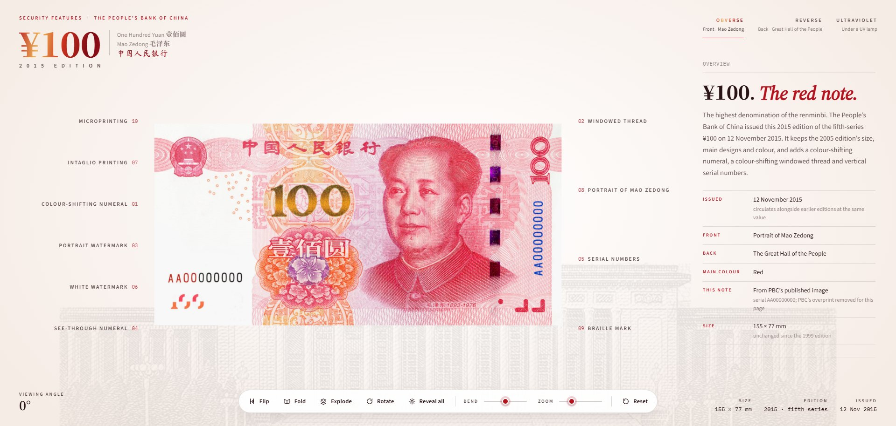 |
| Swiss franc | CHF 1000 (ninth series, 2019) | [chf-1000](https://xuanx1.github.io/mostCirculatedproduct/chf-1000/) | 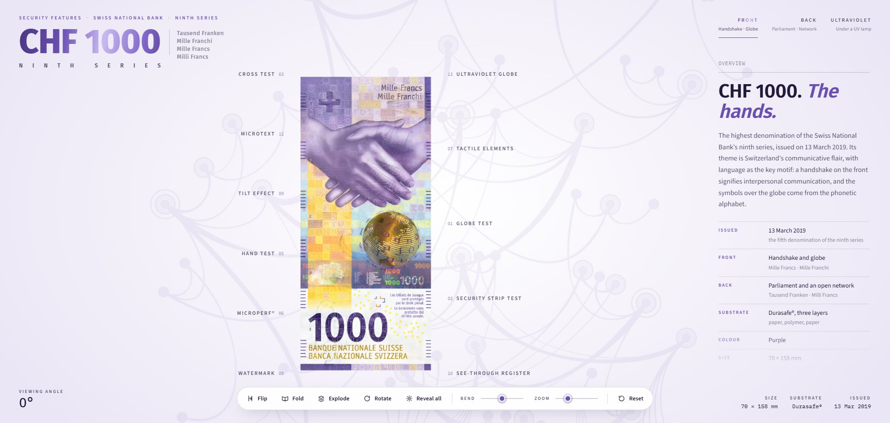 |
| Australian dollar | $100 (next generation polymer, 2020) | [aud-100](https://xuanx1.github.io/mostCirculatedproduct/aud-100/) | 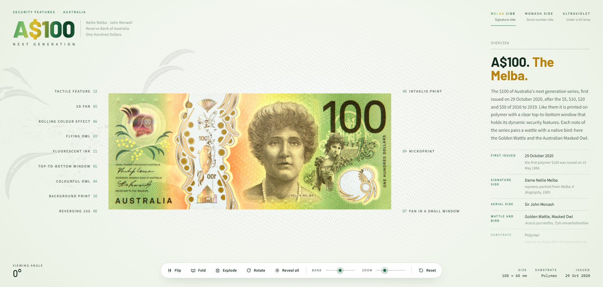 |
| Canadian dollar | $100 (Frontier polymer, 2011) | [cad-100](https://xuanx1.github.io/mostCirculatedproduct/cad-100/) | 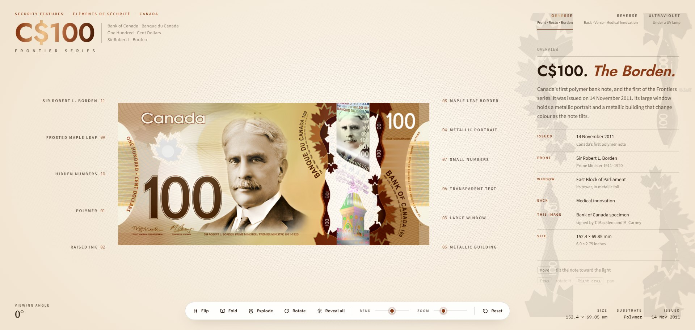 |
| Hong Kong dollar | HK$1,000 (2018 series) ², by each of its three issuing banks: HSBC, Standard Chartered, Bank of China (Hong Kong) | [HSBC](https://xuanx1.github.io/mostCirculatedproduct/hkd-1000/) · [Standard Chartered](https://xuanx1.github.io/mostCirculatedproduct/hkd-1000-scb/) · [Bank of China](https://xuanx1.github.io/mostCirculatedproduct/hkd-1000-boc/) | 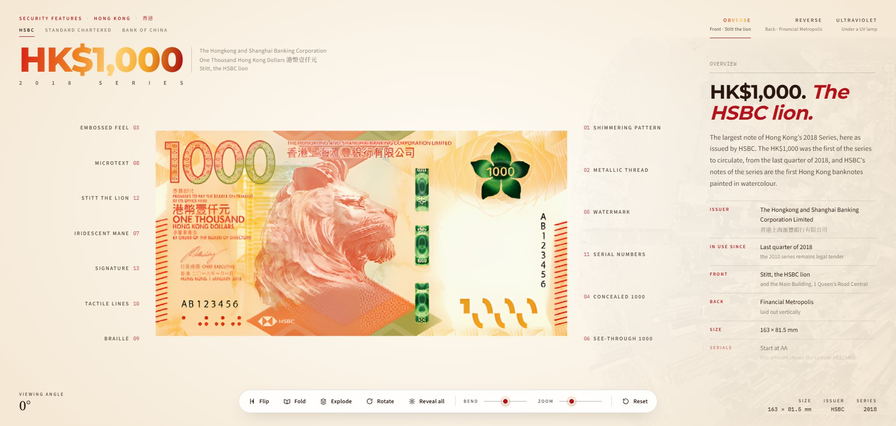 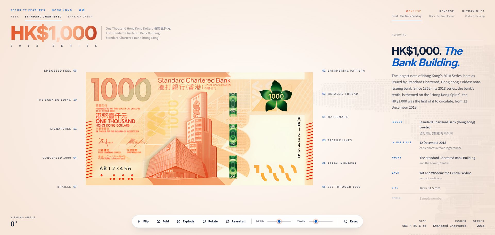 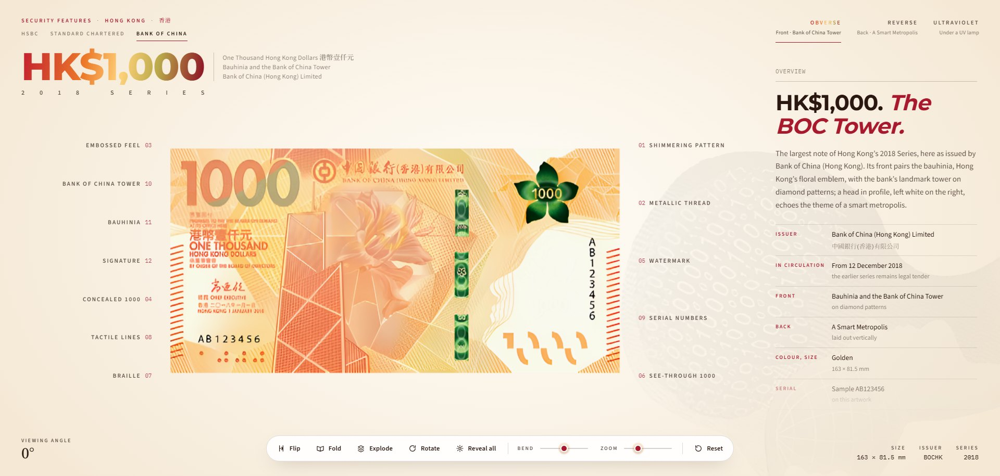 |
| Singapore dollar | S$10,000 (Portrait Series) ¹ | [sgd-10000](https://xuanx1.github.io/mostCirculatedproduct/sgd-10000/) | 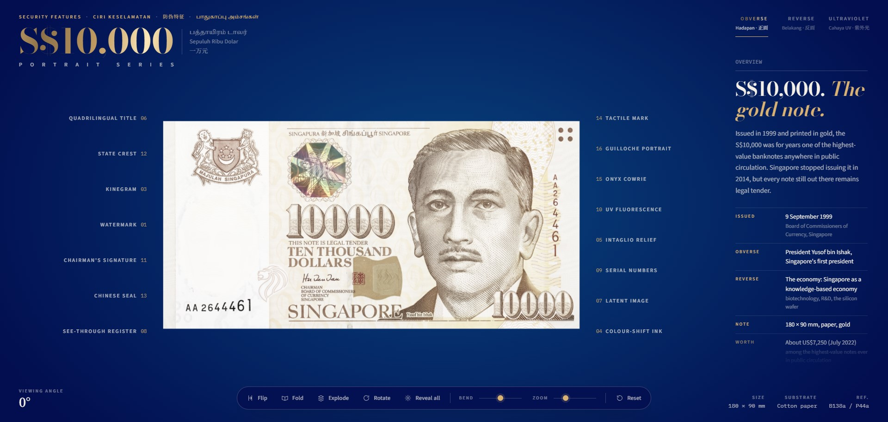 |

¹ Still legal tender but no longer issued: the €500 since 2019, the S$10,000 since 2014. They remain the highest denominations of their currencies.
² Hong Kong notes are issued by three banks (HSBC, Standard Chartered, Bank of China), each with its own design. All three are here, with a switcher between them on each page.
³ Commons had no usable image; the Bank of England's own specimen images exist as a matching front-and-back pair only for the Queen Elizabeth II version. Notes with King Charles III have been issued since 5 June 2024.
⁴ There is no 2019-edition ¥100: the People's Bank of China's 2019 edition covers the ¥50, ¥20, ¥10 and ¥1. The ¥100 in issue is the 2015 edition.
- **Printing or saving as PDF** prints a flat front covered by the EURion constellation, the ring pattern many colour copiers detect.

## Specimen markings

Several issuers only publish images overprinted SPECIMEN (or 样币), and no unmarked flat images of those notes were found. The marking has been removed with **LaMa** inpainting (Suvorov et al., 2022, `big-lama` model): each letter of the overprint is masked separately, real print it crosses is protected, and LaMa fills the letters from the print around them. Each folder's README describes its run, what was removed and what traces remain. The untouched images are kept in each folder's `source/`.

## Reproductions

These pages are for education about anti-counterfeiting features. The note images are reproductions for illustration only and are not legal tender.
